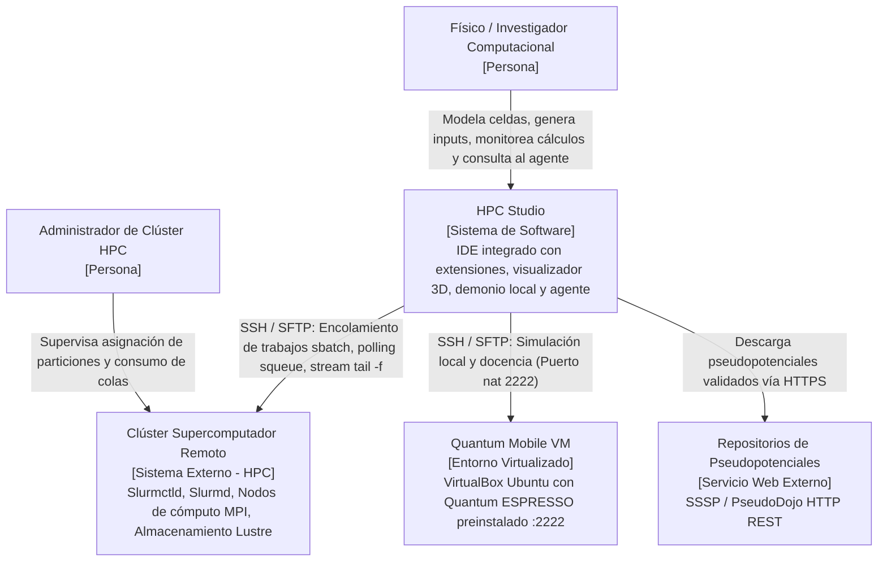
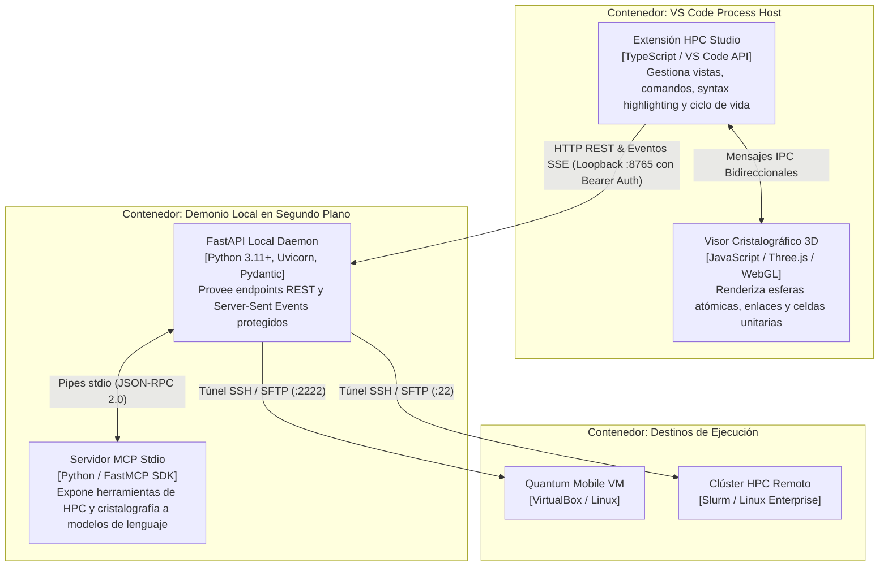
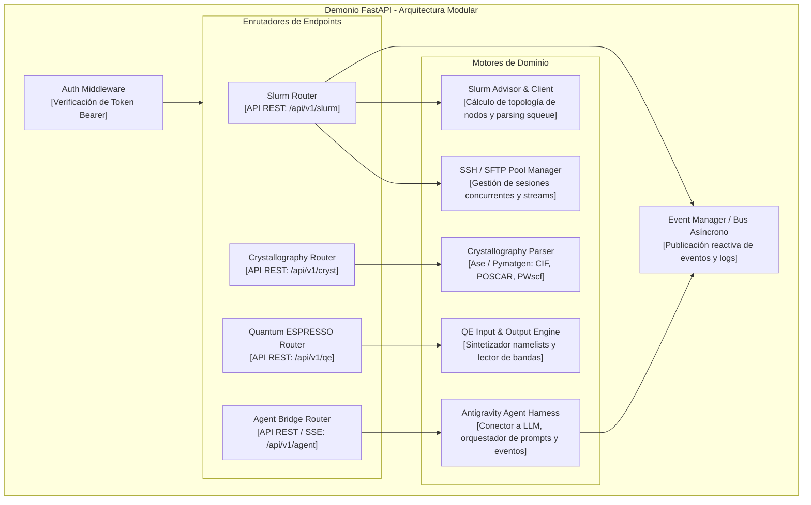

# Documento de Arquitectura de Software - HPC Studio
## Estructura arc42 (ISO/IEC/IEEE 42010:2022) y Modelado C4

**Sistema:** HPC Studio (Estación de Cómputo Científico y Simulación de Materiales)  
**Institución:** Universidad de Cartagena - Programa de Ingeniería de Sistemas  
**Fecha:** Octubre 2026  
**Versión:** 1.0.0-PROD  

---

## 1. Introducción y Metas

HPC Studio es una plataforma integral para científicos computacionales, físicos del estado sólido e ingenieros químicos que permite diseñar, parametrizar, despachar y analizar simulaciones cuánticas *ab initio* (Quantum ESPRESSO, AiiDA) sobre clústeres de supercómputo heterogéneos gestionados por Slurm.

### 1.1 Metas de Calidad Priorizadas
1. **Rendimiento e Interactividad Fluida:** Visualización tridimensional WebGL a 60 FPS y tiempos de respuesta de API local inferiores a 50 ms.
2. **Seguridad y Confidencialidad:** Gestión segura de llaves SSH y tokens de autorización efímeros sin persistencia insegura en disco.
3. **Resiliencia Operativa:** Supervisión continua de trabajos de largo aliento con reconexión automática de túneles SSH y streaming de logs tolerante a caídas de red.
4. **Extensibilidad e Interoperabilidad:** Estandarización de herramientas mediante el protocolo MCP (Model Context Protocol) para su consumo transparente por modelos y agentes de IA.

### 1.2 Partes Interesadas (Stakeholders)
* **Investigadores Científicos:** Requieren una interfaz ágil para inspeccionar cristales y monitorear cálculos sin lidiar con comandos oscuros de consola.
* **Administradores de Supercómputo (HPC Sysadmins):** Buscan reducir el desperdicio de ciclos de CPU/GPU originado por scripts Slurm erróneos.
* **Desarrolladores de Software Científico:** Necesitan una base desacoplada y bien documentada para extender algoritmos de DFT y parsers cristalográficos.

---

## 2. Restricciones de Arquitectura

* **Entorno de Escritorio:** Debe ejecutarse de manera nativa integrado en Visual Studio Code (v1.90+), compatible con Linux, macOS y Windows.
* **Modelo Sidecar Obligatorio:** VS Code impone un entorno de ejecución en Node.js/TypeScript monohilo, por lo que las operaciones analíticas pesadas (matrices cristalográficas, parsers masivos de texto, SSH pool multihilo) deben ejecutarse en un demonio Python externo.
* **Protocolo de IA:** Las capacidades de agente deben adherirse estrictamente a la especificación estándar del **Model Context Protocol (v2024-11-05)**.

---

## 3. Contexto y Alcance

### C4 Nivel 1: Diagrama de Contexto del Sistema

El siguiente diagrama delimita las fronteras de HPC Studio, sus usuarios directos y los sistemas externos con los que interactúa.



---

## 4. Estrategia de Solución

* **Desacoplamiento Frontend/Backend (Sidecar Pattern):** La interfaz de usuario reside en la extensión TypeScript de VS Code, delegando la lógica de cálculo a un demonio local FastAPI en Python mediante HTTP/SSE en `127.0.0.1`.
* **Seguridad Criptográfica en Memoria:** Cada sesión genera dinámicamente un token secreto Bearer de un solo uso que protege todas las llamadas al demonio local frente a accesos no autorizados por otros procesos del sistema operativo.
* **Pooling Asíncrono de Conexiones SSH:** Implementación de un gestor de conexiones con reutilización de canales SFTP y sockets, evitando el costo de negociación criptográfica en cada comando remoto.
* **Renderizado WebGL Aislado:** La vista 3D opera dentro de un Webview independiente con Three.js, comunicándose con el editor mediante un protocolo bidireccional de paso de mensajes IPC.

---

## 5. Vista de Bloques de Construcción

### C4 Nivel 2: Diagrama de Contenedores

Descomposición de alto nivel de las unidades de ejecución de HPC Studio.



---

### C4 Nivel 3: Diagrama de Componentes del Backend (FastAPI Daemon)

Descomposición interna del contenedor FastAPI Daemon en sus módulos y controladores.



---

## 6. Vista de Tiempo de Ejecución (Runtime View)

Las interacciones dinámicas clave corresponden a los flujos modelados en la Vista de Procesos:
1. **Inicialización e intercambio de credenciales:** El host VS Code arranca el demonio asignando un puerto efímero y un token de autenticación que es validado en cada petición entrante mediante `HTTPBearer`.
2. **Ciclo de Despacho y Watchdog:** El demonio envía scripts Slurm vía SFTP, ejecuta `sbatch`, obtiene el ID del trabajo y suscribe un hilo asíncrono para verificar periódicamente el estado (`squeue`) y emitir eventos SSE hacia la interfaz.
3. **Flujo de Agente e Invocación de Herramientas MCP:** El agente cognitivo interpreta las consultas del usuario, solicita la ejecución de herramientas especializadas (`validate_qe_input`, `check_slurm_queue`), el servidor MCP las resuelve en Python y entrega el resultado estructurado para que el modelo elabore su respuesta.

---

## 7. Vista de Despliegue

### C4 Nivel 4: Diagrama de Despliegue de Infraestructura

```mermaid
deploymentNode LocalMachine [Estación de Trabajo del Científico / SO Anfitrión]
    deploymentNode Electron [Proceso VS Code Workbench]
        artifact HPCStudioExt [hpc-studio-1.0.0.vsix]
        artifact ThreeJSBundle [viewer3d.bundle.js]
    end

    deploymentNode PythonEnv [Entorno Virtual Python uv / venv]
        artifact DaemonBinary [hpc_studio.server (Uvicorn / FastAPI)]
        artifact MCPBinary [hpc_studio.mcp (Stdio Server)]
    end

    Electron -- Loopback 127.0.0.1 (TCP :8765) --> PythonEnv
end

deploymentNode Hypervisor [VirtualBox Hypervisor]
    deploymentNode QuantumMobileGuest [VM Quantum Mobile (Ubuntu 22.04 LTS)]
        artifact GuestSSHD [OpenSSH Server :2222]
        artifact LocalQE [Quantum ESPRESSO Binaries: pw.x, ph.x]
        artifact LocalSlurmDaemon [slurmctld / slurmd]
    end
end

deploymentNode SupercomputingCenter [Centro de Supercómputo Institucional]
    deploymentNode LoginCluster [Head Node / Servidor de Entrada]
        artifact ClusterSSHD [OpenSSH Server :22]
        artifact SlurmScheduler [Slurmctld 23.x]
    end

    deploymentNode NodesFabric [Infiniband Network Fabric]
        deploymentNode ComputeRack1 [Nodo de Cómputo 01..32]
            artifact WorkerSlurm [slurmd]
            artifact MPIRuntime [OpenMPI / Intel MPI]
        end
    end
    
    LoginCluster -- Red Infiniband de Baja Latencia --> NodesFabric
end

PythonEnv -- SSH / SFTP Port-Forwarding (localhost:2222) --> GuestSSHD
PythonEnv -- SSH / SFTP WAN con Llave RSA/Ed25519 (:22) --> ClusterSSHD
```

---

## 8. Conceptos Transversales

### 8.1 Seguridad y Modelo de Confianza
* **Principio de Mínimo Privilegio:** El demonio corre bajo el contexto del usuario del sistema operativo sin elevación de privilegios `root` ni sudo.
* **Protección de Loopback:** El servidor FastAPI escucha estrictamente en `127.0.0.1` y rechaza conexiones externas no locales.
* **Almacenamiento de Secretos:** Llaves privadas SSH, frases de paso y tokens de clúster son custodiados mediante `vscode.SecretStorage`, integrándose con los llaveros nativos del sistema operativo (*libsecret* en Linux, *Keychain* en macOS, *Credential Manager* en Windows).

### 8.2 Observabilidad y Manejo de Errores
* **Logs Estructurados:** Utilización de registros JSON estructurados con niveles `DEBUG`, `INFO`, `WARNING` y `ERROR`.
* **Resiliencia de Conexión:** Estrategia de reintentos exponenciales con *jitter* para operaciones remotas SSH/SFTP propensas a microcortes de red.

---

## 9. Decisiones de Arquitectura (ADRs)

Las decisiones clave del sistema se formalizan mediante registros MADR disponibles en `docs/adr/`:
* [ADR-0001: Arquitectura Sidecar Desacoplada](file:///home/nosedimetuxd/Proyectos/HPC%20Studio/docs/adr/0001-arquitectura-sidecar-desacoplada.md)
* [ADR-0002: Servidor MCP Stdio para Agentes de IA](file:///home/nosedimetuxd/Proyectos/HPC%20Studio/docs/adr/0002-servidor-mcp-stdio-para-agentes-ia.md)
* [ADR-0003: Visor 3D WebGL Three.js Embebido](file:///home/nosedimetuxd/Proyectos/HPC%20Studio/docs/adr/0003-visor-3d-webgl-threejs-embebido.md)
* [ADR-0004: Preset Quantum Mobile VirtualBox](file:///home/nosedimetuxd/Proyectos/HPC%20Studio/docs/adr/0004-preset-quantum-mobile-virtualbox.md)
* [ADR-0005: Integración Antigravity Agent Harness en Core](file:///home/nosedimetuxd/Proyectos/HPC%20Studio/docs/adr/0005-integracion-antigravity-agent-harness-core.md)

---

## 10. Requisitos de Calidad (Escenarios ISO/IEC 25000)

| ID Escenario | Atributo de Calidad | Estímulo | Fuente del Estímulo | Entorno | Respuesta del Sistema | Medida de Respuesta |
| :--- | :--- | :--- | :--- | :--- | :--- | :--- |
| **ESC-01** | Eficiencia de Rendimiento | Apertura de archivo CIF con 250 átomos y generación de supercelda $2 \times 2 \times 2$. | Usuario | Workbench activo | Parseo geométrico y actualización tridimensional fluida. | Tiempo total < 1.2 segundos; renderizado a 60 FPS sin congelar el editor. |
| **ESC-02** | Seguridad | Petición HTTP al demonio FastAPI sin cabecera `Authorization`. | Proceso no autorizado | Loopback 127.0.0.1 | Rechazo inmediato de la conexión con código HTTP 401 Unauthorized. | Latencia < 5 ms; ninguna información de clúster expuesta. |
| **ESC-03** | Fiabilidad | Interrupción abrupta de la conexión de red durante el streaming de salida Slurm. | Infraestructura de red WAN | Trabajo Slurm en ejecución remota | El Watchdog detecta desconexión, activa reconexión automática y reanuda el cursor de logs. | Reanudación sin pérdida de líneas de log ni terminación del proceso cliente. |

---

## 11. Riesgos y Deuda Técnica

1. **Riesgo: Variaciones de versiones de Slurm en clústeres heterogéneos:**  
   * *Mitigación:* Se implementa un parser tolerante a variaciones en la salida estándar de `squeue` y `sinfo`, utilizando formatos delimitados estrictos (`--format="%i|%j|%T|%M|%l|%D|%R"`).
2. **Riesgo: Sobrecarga de memoria en visualización de superceldas masivas:**  
   * *Mitigación:* Se utilizan geometrías instanciadas en Three.js (`InstancedMesh`), compartiendo una única geometría esférica para todos los átomos del mismo elemento químico.

---

## 12. Glosario Técnico

Ver sección 1.4 del [Manual del Sistema 4+1](file:///home/nosedimetuxd/Proyectos/HPC%20Studio/docs/arquitectura/manual_del_sistema_4plus1.md) para las definiciones conceptuales y ontología de dominio compartida.
