# MANUAL DEL SISTEMA PARA HPC STUDIO
## Arquitectura en Vistas 4+1 (Kruchten) y Modelo de Negocio Científico

**Proyecto:** HPC Studio (Quantum Studio Core)  
**Institución:** Universidad de Cartagena - Programa de Ingeniería de Sistemas  
**Facultad:** Facultad de Ingeniería  
**Línea de Investigación:** Computación de Alto Rendimiento (HPC), Inteligencia Artificial Aplicada y Física Computacional de Materiales  
**Fecha:** Octubre 2026  
**Versión:** 1.0.0-PROD  

---

## Introducción

El presente **Manual del Sistema** documenta la arquitectura técnica, el modelo de negocio científico y los patrones de diseño de **HPC Studio**, una estación de trabajo integrada e inteligente para computación científica de alto rendimiento (*High Performance Computing* - HPC) orientada al modelado de materiales cuánticos y la simulación ab initio mediante *Quantum ESPRESSO* y *AiiDA*.

HPC Studio resuelve la brecha existente entre los entornos de desarrollo integrados modernos (IDE) y los clústeres de supercómputo heterogéneos gestionados por el planificador *Slurm Workload Manager*. A través de un acoplamiento desacoplado en modo *Sidecar* (extensión nativa en TypeScript para VS Code y un demonio asíncrono en Python/FastAPI), un visor cristalográfico 3D acelerado por WebGL (Three.js), un servidor de protocolo de contexto de modelos (*Model Context Protocol* - MCP stdio) y un arnés de agentes inteligentes autónomos (*Antigravity Agent Core*), la plataforma democratiza y optimiza los flujos de trabajo computacionales de la física de la materia condensada.

El documento se estructura bajo el estándar de modelado de software **Modelo 4+1 de Philippe Kruchten**, complementado con los lineamientos de calidad **ISO/IEC 25000 (SQuaRE)** y la plantilla formal **arc42**.

---

## 1. Modelo de Negocio

El modelo de negocio de HPC Studio se enmarca en la aceleración de la investigación científica y la optimización de recursos en laboratorios e institutos de cómputo avanzado. La plataforma opera como un facilitador de productividad para investigadores, reduciendo tiempos muertos de configuración y errores sintácticos en el envío de cálculos costosos en clústeres supercomputacionales.

### 1.1 Procesos de Negocio Científicos

Los procesos esenciales del ciclo de vida de la simulación cuántica se modelan a continuación mediante diagramas de actividades UML estructurados en Mermaid.

#### Proceso 1: Preparación de Simulación de Materiales y Validación Cristalográfica
* **Objetivo:** Ingestar archivos de estructura atómica (CIF, PWscf input, XYZ, PDB, POSCAR), parsear la geometría cristalográfica, generar la celda unitaria con superceldas periódicas, validar pseudopotenciales proyectores y construir el script de cálculo cuántico libre de inconsistencias físicas.
* **Entradas:** Archivo estructural de material, parámetros SCF/relax (cutoff de energía, k-points, smearing, funcionales de intercambio-correlación).
* **Salidas:** Archivo de entrada Quantum ESPRESSO (`.in`) verificado, celda normalizada y previsualizada en 3D.

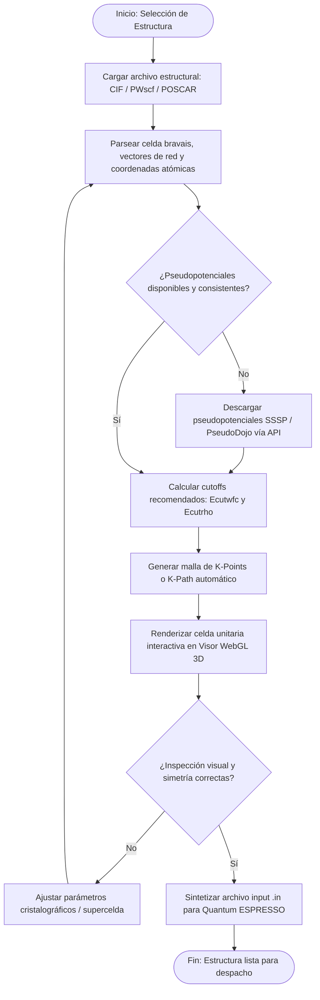

#### Proceso 2: Despacho y Monitoreo Asíncrono en Supercomputador (Slurm Orchestration)
* **Objetivo:** Empaquetar scripts de cálculo y pseudopotenciales, transferirlos de forma segura a través de túneles SFTP con pooling reutilizable, despachar el trabajo al gestor de colas Slurm con parámetros óptimos de paralelismo (MPI/OpenMP) y monitorear la ejecución en tiempo real mediante *streaming* de logs y *watchdog* de estado.
* **Entradas:** Archivo `.in`, configuración del clúster (partición, nodos, tareas MPI, walltime).
* **Salidas:** Identificador de trabajo (Job ID), flujo continuo de logs, archivo de salida (`.out`) y captura de señales térmicas/límites de tiempo.

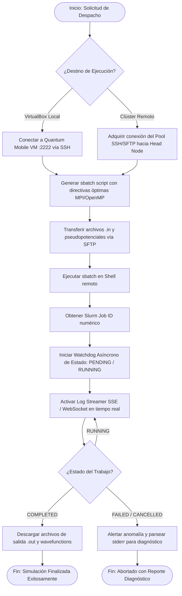

#### Proceso 3: Análisis Cuántico Post-Cálculo y Extracción de Propiedades Físicas
* **Objetivo:** Parsear las salidas voluminosas de Quantum ESPRESSO, extraer la trayectoria de relajación iónica, energía libre total, convergencia de gradientes de fuerza, magnetización y curvas de dispersión de bandas electrónicas o densidad de estados (DOS).
* **Entradas:** Archivo de salida `.out`, archivos `.xml` de exportación y matrices de densidades.
* **Salidas:** Gráficas de convergencia energética, diagrama de estructura de bandas electrónicas, estados proyectados (PDOS) y tensor de esfuerzos.

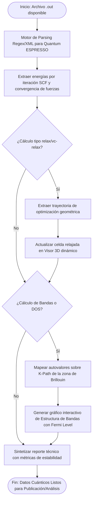

---

### 1.2 Casos de Uso del Negocio (Mundo Real)

Para diferenciar claramente el comportamiento científico antes de la mediación del software de escritorio, se detallan dos casos de uso de negocio esenciales:

#### Caso de Negocio CN-01: Físico Computacional en Investigación de Nuevos Materiales
* **Actor Principal:** Físico Teórico / Ingeniero de Materiales.
* **Escenario:** El investigador requiere modelar la transición de fase bajo presión de una perovskita semiconductora. Tradicionalmente, esto requería:
  1. Crear a mano un archivo de texto con parámetros complejos en formato FORTRAN Namelists (`&CONTROL`, `&SYSTEM`, `&ELECTRONS`).
  2. Conectarse manualmente mediante cliente de terminal SSH genérico al clúster remoto.
  3. Escribir scripts `sbatch` ad-hoc lidiando con flags oscuros de asignación de sockets y nodos.
  4. Monitorear ejecutando `squeue` repetidamente en terminales separadas.
  5. Descargar gigabytes de salidas y usar programas externos obsoletos para verificar visualmente que los átomos no colapsaran.
* **Valor agregado por HPC Studio:** Centraliza todo el ciclo de vida en el editor: generación guiada de la celda, visualización 3D interactiva en tiempo real, sbatch con recomendaciones automáticas del hardware del clúster, streaming continuo de convergencia y asistencia heurística por agentes IA en caso de divergencia matemática de la matriz hamiltoniana.

#### Caso de Negocio CN-02: Administrador de Infraestructura y Clúster HPC
* **Actor Principal:** Administrador de Sistemas HPC / Sysadmin.
* **Escenario:** El administrador gestiona clústeres heterogéneos universitarios con particiones de cómputo dedicadas a CPU (Intel Xeon / AMD EPYC) y GPU (NVIDIA A100). Frecuentemente los investigadores inexpertos bloquean colas solicitando directivas `nodes`, `ntasks-per-node` y `cpus-per-task` inconsistentes que provocan *OOM (Out Of Memory)* o subutilización masiva de núcleos.
* **Valor agregado por HPC Studio:** El subsistema `SlurmAdvisor` analiza dinámicamente las particiones remotas (`sinfo`), calcula la topología de núcleos/sockets y sugiere configuraciones validadas por límites de cuota, minimizando los tickets de soporte por fallos de configuración de Slurm.

---

### 1.3 Modelo de Dominio Conceptual

El modelo conceptual del dominio captura la ontología esencial del supercómputo y la física del estado sólido, independiente de frameworks de presentación.

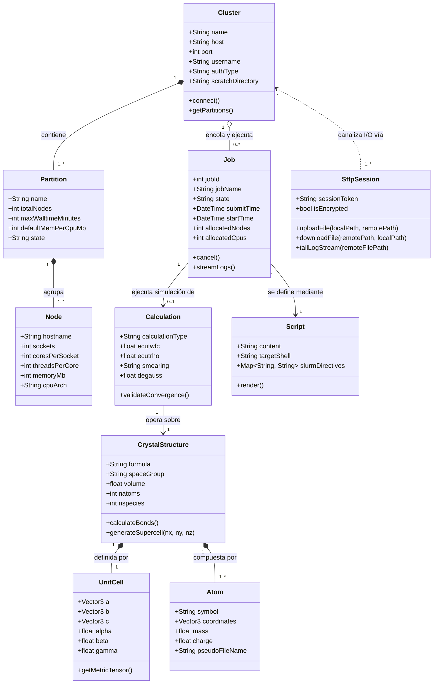

---

### 1.4 Glosario de Supercómputo y Simulación de Materiales

| Término | Definición en el Contexto del Negocio y Sistema |
| :--- | :--- |
| **Ab Initio / DFT** | Cálculos de mecánica cuántica basados en la Teoría del Funcional de la Densidad (Density Functional Theory) para resolver la ecuación de Schrödinger electrónica sin parámetros empíricos ajustables. |
| **Quantum ESPRESSO (QE)** | Suite integrada de código abierto para cálculos de estructura electrónica de primeros principios basada en ondas planas y pseudopotenciales. Incluye módulos como `pw.x`, `ph.x` y `bands.x`. |
| **Slurm Workload Manager** | Sistema de gestión de clústeres y planificación de trabajos de alta escalabilidad y tolerancia a fallos ampliamente utilizado en los principales centros de supercómputo del mundo. |
| **Head Node (Nodo Maestro)** | Servidor de acceso y login del clúster donde los usuarios se autentican, compilan códigos y envían trabajos a las colas; nunca se ejecutan cálculos pesados directamente en él. |
| **Compute Node (Nodo de Cómputo)** | Nodos de procesamiento dedicados donde se ejecutan los contenedores y procesos MPI del trabajo computacional asignado por el scheduler Slurm. |
| **Pseudopotencial** | Aproximación cuántica que reemplaza los efectos de los electrones de los núcleos internos y el potencial coulombiano nuclear fuerte por un potencial efectivo más suave que actúa sobre los electrones de valencia. |
| **Celda Unitaria (Unit Cell)** | La unidad espacial tridimensional más pequeña de un cristal que, repetida periódicamente mediante traslaciones de red, genera el cristal macroscópico completo. |
| **K-Points / Malla Monkhorst-Pack** | Muestreo discreto de vectores de onda en la primera Zona de Brillouin utilizado para integrar densidades de estados y energías totales en sistemas periódicos. |
| **Sidecar Pattern** | Patrón arquitectónico donde un proceso auxiliar complementario (FastAPI Daemon) corre de forma co-localizada junto al proceso anfitrión principal (VS Code) para extender sus capacidades sin impactar su memoria o latencia de UI. |
| **Model Context Protocol (MCP)** | Protocolo abierto estandarizado por Anthropic para permitir a modelos de lenguaje (LLM) y agentes inteligentes interactuar de forma segura y estandarizada con herramientas, recursos y servidores locales/remotos. |

---

## 2. Requisitos del Sistema y Árbol de Calidad

### 2.1 Síntesis de Requisitos Funcionales

* **RF-01 Gestión Multiclúster:** Conexión concurrente y segura vía SSH/SFTP hacia múltiples clústeres HPC (Head Nodes) y máquinas virtuales locales (Quantum Mobile).
* **RF-02 Generación y Asesoría Slurm:** Generación contextual de scripts `.sbatch` con cálculo de topología óptima de sockets, cores y memoria recomendada.
* **RF-03 Telemetría y Streaming de Logs:** Inspección en vivo de colas de trabajos (`squeue`, `sinfo`), control de ciclo de vida (`scancel`, `scontrol`) y transmisión de salida en vivo vía Server-Sent Events (SSE).
* **RF-04 Motor Cristalográfico y Visor 3D:** Parseo de geometrías, cálculo de matrices métricas de red, generación de superceldas y renderizado interactivo tridimensional con Three.js en Webview aislada.
* **RF-05 Servidor de Inteligencia MCP:** Exposición de herramientas de dominio (inspección de clúster, validación de inputs cuánticos, consultas cristalográficas) bajo especificación JSON-RPC 2.0 stdio.
* **RF-06 Arnés de Agentes Autónomos:** Soporte nativo para sesiones de agentes cognitivos capaces de diagnosticar fallos en cálculos cuánticos, proponer correcciones automáticas y ejecutar herramientas seguras.

### 2.2 Árbol de Calidad ISO/IEC 25000 (SQuaRE)

El estándar **ISO/IEC 25010** guía los atributos no funcionales críticos del sistema HPC Studio:

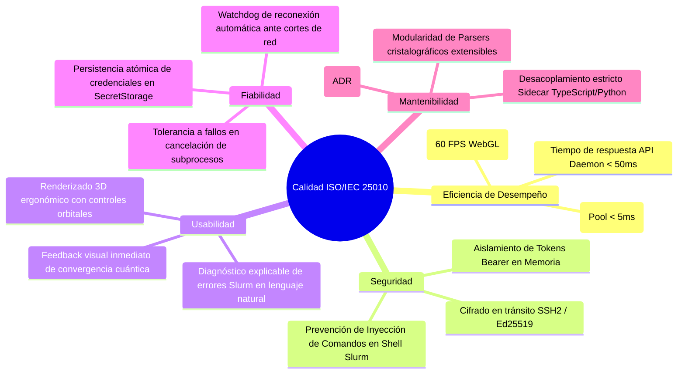

---

## 3. Modelo de Diseño (Vistas 4+1 de Kruchten)

### 3.1 Vista de Escenarios (+1)

La vista de escenarios unifica los requisitos del sistema y guía el diseño de la interacción del usuario.

#### 3.1.1 Diagrama General de Casos de Uso del Software
```mermaid
flowchart LR
    User([Investigador / Usuario])
    
    subgraph HPC Studio Workspace
        UC1[Configurar Clúster HPC / VM]
        UC2[Visualizar Estructura Cristalográfica 3D]
        UC3[Generar y Validar Input Quantum ESPRESSO]
        UC4[Despachar Trabajo Slurm]
        UC5[Monitorear Cola y Stream de Logs en Vivo]
        UC6[Interactuar con Agente Antigravity / MCP]
        UC7[Analizar Convergencia y Bandas Electrónicas]
    end

    User --> UC1
    User --> UC2
    User --> UC3
    User --> UC4
    User --> UC5
    User --> UC6
    User --> UC7

    UC3 ..> UC2 : <<include>>
    UC4 ..> UC1 : <<include>>
    UC5 ..> UC4 : <<extend>>
    UC6 ..> UC3 : <<extend>>
    UC6 ..> UC5 : <<extend>>
```

#### 3.1.2 Argumentación Ergonómica de la GUI
La interfaz de usuario se integra directamente en la barra lateral del Workbench de VS Code mediante el árbol de vistas `hpc-studio.views`, paneles Webview dedicados para el visor de celdas 3D y editores de texto con resaltado de sintaxis especializado para Quantum ESPRESSO (`source.pwscf`) y Slurm (`source.slurm`).

* **Reducción de Carga Cognitiva:** La visualización 3D responde en tiempo real a los cambios que el usuario efectúa en el archivo `.in` en el editor de texto, eliminando el cambio de contexto entre múltiples ventanas.
* **Control Orbital e Inspección Espacial:** El visor Three.js permite rotación libre, zoom, paneo, alternancia de ejes cristalográficos cartesianos vs directos y duplicación periódica de celda mediante controles de fácil acceso.

---

### 3.2 Vista Lógica

La Vista Lógica aborda la estructura estática del sistema, la descomposición en capas y la aplicación rigurosa de patrones de diseño.

#### 3.2.1 Arquitectura por Capas

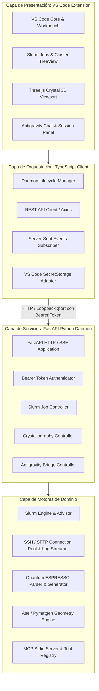

#### 3.2.2 Patrones de Diseño Larman GRASP y GoF Aplicados
* **GRASP Controller:** Los routers de FastAPI (`routes/slurm.py`, `routes/crystallography.py`) operan como controladores de casos de uso del backend, recibiendo solicitudes DTO validadas con Pydantic y delegando la computación pesada a los gestores de dominio.
* **GRASP Information Expert:** Las entidades `CrystalStructure` y `UnitCell` encapsulan el cálculo de vectores métricos, distancias interatómicas de enlace y matrices de traslación periódica, siendo las expertas en su información geométrica.
* **GRASP Low Coupling / High Cohesion:** El subsistema SSH/SFTP mantiene cohesión alta en operaciones remotas y desacopla completamente el motor de cálculo cuántico de los detalles de sockets o red de bajo nivel.
* **GoF Adapter:** La interfaz de proveedores de IA (`AgentProvider`) cuenta con adaptadores concretos (`AntigravityProvider`, `OpenAIProvider`, `AnthropicProvider`), permitiendo que el arnés de agentes consuma cualquier motor sin modificar su lógica central.
* **GoF Factory:** `SlurmScriptGenerator` utiliza el patrón Factory Method para construir scripts de ejecución personalizados dependiendo del tipo de cálculo cuántico solicitado (SCF, Relax, Bands, Phonons) y del perfil del clúster de destino.
* **GoF Observer / Publish-Subscribe:** El `EventManager` y los `EventBus` en Python gestionan eventos asíncronos (`JobSubmittedEvent`, `JobStatusChangedEvent`, `LogAppendedEvent`) distribuyéndolos de forma reactiva a los suscriptores SSE que alimentan la interfaz gráfica.

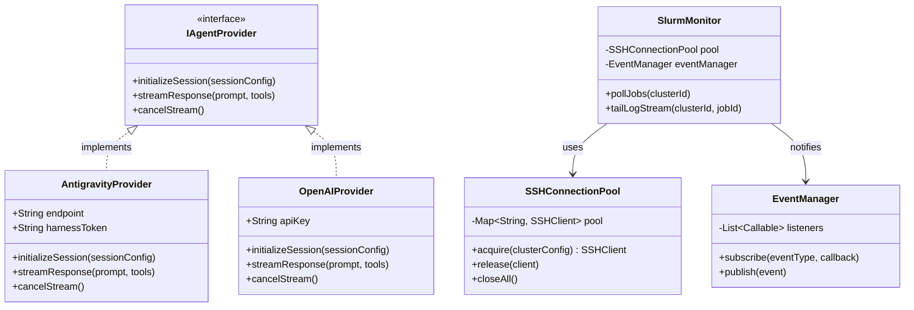

---

### 3.3 Vista de Procesos

La Vista de Procesos expone los aspectos dinámicos de concurrencia, sincronización de subprocesos y comunicación entre componentes mediante diagramas de secuencia UML detallados.

#### Escenario 1: Arranque y Handshake Seguro del Sidecar Daemon
Al inicializar la extensión en VS Code, se localiza un puerto dinámico libre en `localhost`, se genera un secreto criptográfico aleatorio (UUIDv4/Hex) en memoria y se lanza el subproceso Python del demonio FastAPI, validando el handshake inicial antes de exponer las funcionalidades.

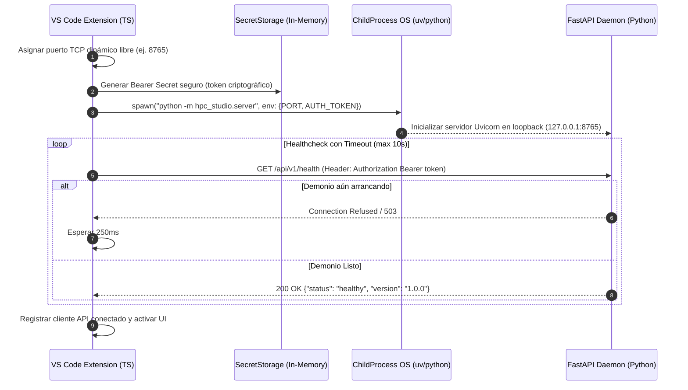

#### Escenario 2: Envío de Trabajo Slurm con Streaming de Salida en Vivo (Log Streamer)
Flujo de interacción asíncrono para despachar un cálculo y mantener actualizado al usuario sin bloqueos en la interfaz gráfica.

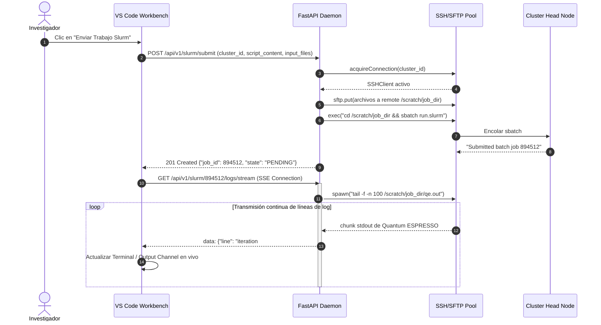

#### Escenario 3: Streaming de Agente Antigravity y Ejecución de Herramientas MCP
Flujo interactivo donde el usuario solicita optimizar o diagnosticar una simulación al arnés de agentes, quien consulta herramientas cristalográficas y del clúster mediante MCP.

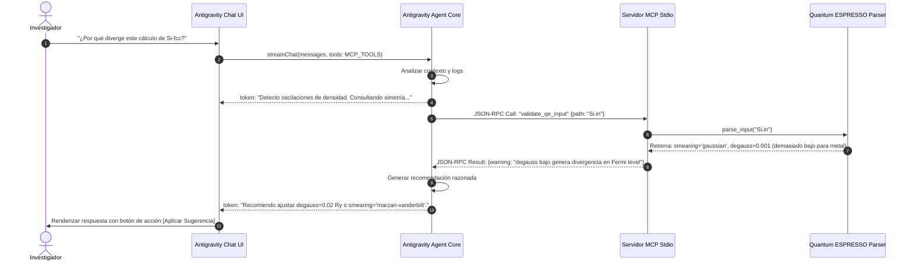

---

### 3.4 Vista de Desarrollo

La Vista de Desarrollo detalla la organización física de los módulos de software, subsistemas y dependencias de librerías.

```mermaid
flowchart TD
    subgraph RepoRoot [Estructura del Proyecto HPC Studio]
        subgraph VSExtension [vscode/extensions/hpc-studio]
            PackageJSON[package.json: Manifest, Menus, Contributes]
            TSConfig[tsconfig.json: TypeScript 5.x Strict]
            SrcTS[src/extension.ts: Extension Lifecycle & Activation]
            WebviewDir[media/viewer3d: Three.js Bundle & Shaders]
            ViewsDir[src/views: TreeView Providers & Sidebars]
            ClientDir[src/client: Daemon REST & SSE Client]
        end

        subgraph PythonBackend [HPC Studio/src/hpc_studio]
            CoreMod[core/: Configuration, State & Signals]
            ServerMod[server/: FastAPI Routers, Auth & Lifespan]
            SlurmMod[slurm/: Slurm Client, Generator, Watchdog]
            CrystMod[crystallography/: Parsers, Models & KPath]
            QEMod[qe/: QE Generator, Output Parser, Pseudos]
            SSHMod[ssh/ & sftp/: AsyncSSH & Paramiko Connection Pool]
            AgentMod[agent/: Antigravity Bridge & Event Streaming]
            MCPMod[mcp/: FastMCP / JSON-RPC Stdio Server]
        end
    end

    VSExtension -->|"Lanza y consume vía HTTP/IPC"| PythonBackend
```

* **Dependencias Clave Frontend:** `@types/vscode`, `three` (WebGL 3D rendering), `@vscode/webview-ui-toolkit`.
* **Dependencias Clave Backend:** `fastapi`, `uvicorn`, `pydantic` (v2), `paramiko` / `asyncssh`, `ase` (Atomic Simulation Environment), `pymatgen` (Crystallography Engine), `mcp` (Anthropic Model Context Protocol SDK).

---

### 3.5 Vista Física / Despliegue

La Vista Física describe la asignación de artefactos de software sobre la infraestructura física y de red, conectando estaciones de trabajo locales con entornos virtuales y clústeres remotos.

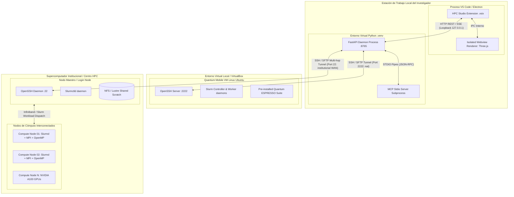

---

## 4. Conclusiones y Trazabilidad

El presente manual del sistema demuestra la solidez de la arquitectura en vistas 4+1 para HPC Studio. La separación nítida entre la experiencia interactiva en VS Code y el núcleo analítico en Python permite a los investigadores realizar simulaciones de materiales cuánticos con altos estándares de productividad, seguridad y rendimiento computacional.
