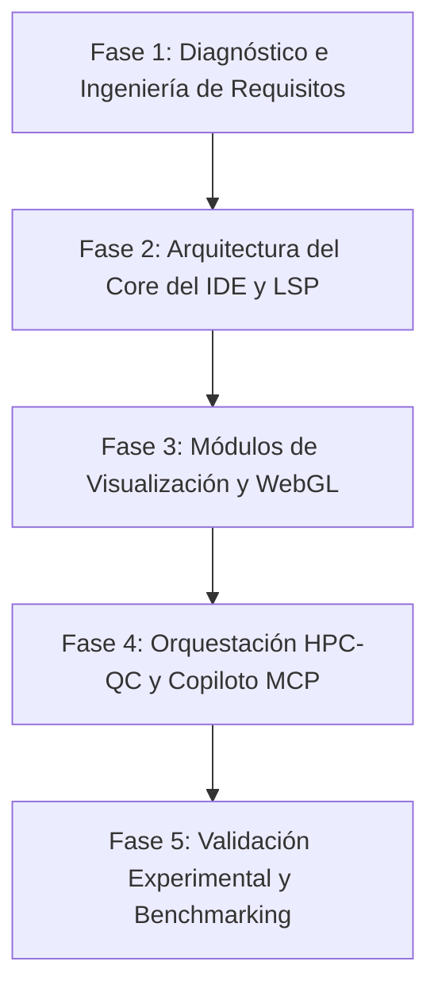

# Diseño e Implementación de un Entorno de Desarrollo Integrado (IDE) Especializado para la Ingeniería de Software Cuántico y la Simulación Híbrida HPC-QC

**Autor:** Investigador / Equipo de Desarrollo de HPC Studio  
**Afiliación:** Laboratorio de Supercómputo y Simulación Científica  
**Fecha:** Octubre de 2026  
**Formato:** Normas APA (7.ª edición)

---

### Resumen
El paradigma emergente de la computación cuántica en la era de Escala Intermedia con Ruido (NISQ, por sus siglas en inglés) enfrenta una brecha sustancial en sus capas de abstracción e interacción humana: la ausencia de entornos de desarrollo integrados (IDE) dedicados que trasciendan las limitaciones lineales de los cuadernos de notas (*notebooks*). Esta investigación propone el diseño, fundamentación arquitectónica e implementación prototípica de **Quantum Studio**, un IDE nativo y modular de código abierto optimizado para el diseño, simulación, visualización geométrica y transpilación de circuitos cuánticos, con soporte explícito para flujos híbridos cuántico-clásicos (HPC-QC). La plataforma integra un servidor de lenguaje (*Language Server Protocol*, LSP) para OpenQASM 3.0, un motor reactivo de representación gráfica de circuitos, un módulo WebGL tridimensional para la proyección de estados en la Esfera de Bloch y variedades de subespacios multiqubit, conectores bidireccionales con gestores de carga de trabajo de supercómputo (Slurm) y unidades de procesamiento cuántico (QPU) en la nube, y una capa de asistencia algorítmica impulsada por agentes de inteligencia artificial mediante el *Model Context Protocol* (MCP). La metodología de investigación adopta un enfoque de diseño e ingeniería de software basado en artefactos (*Design Science Research*), evaluando métricas de latencia cognitiva, fidelidad sintáctica y rendimiento de transpilación frente a flujos de trabajo convencionales.

*Palabras clave:* Computación cuántica, IDE, OpenQASM 3.0, Esfera de Bloch, HPC-QC, transpilación de circuitos, ingeniería de software cuántico.

---

### Abstract
The emerging paradigm of quantum computing in the Noisy Intermediate-Scale Quantum (NISQ) era faces a substantial barrier within its interaction and abstraction layers: the lack of dedicated, native integrated development environments (IDEs) capable of surpassing the linear constraints of computational notebooks. This research presents the design, architectural foundation, and prototyping of **Quantum Studio**, an open-source, native, and modular IDE specifically engineered for quantum circuit synthesis, multi-paradigm simulation, geometric state visualization, and compilation, featuring native support for hybrid quantum-classical workflows (HPC-QC). The platform integrates a Language Server Protocol (LSP) for OpenQASM 3.0, a reactive SVG/WebGL circuit diagramming engine, a 3D WebGL renderer for multi-qubit Bloch sphere representations, bidirectional connectors to supercomputing workload schedulers (Slurm) and remote Quantum Processing Units (QPUs), and an agentic AI optimization layer powered by the Model Context Protocol (MCP). The research follows a Design Science Research Methodology (DSRM), assessing cognitive task latency, syntactic verification fidelity, and compilation efficiency against standard contemporary toolchains.

*Keywords:* Quantum computing, IDE, OpenQASM 3.0, Bloch sphere, HPC-QC, circuit transpilation, quantum software engineering.

---

## 1. Introducción y Planteamiento del Problema

La computación cuántica representa uno de los saltos cualitativos más significativos en la historia del procesamiento de la información, prometiendo resolver problemas computacionalmente intratables para los procesadores de von Neumann clásicos en campos como la simulación de materiales moleculares, el modelado farmacológico, la criptografía poscuántica y la optimización combinatoria compleja (Nielsen & Chuang, 2010; Preskill, 2018).

A pesar del vertiginoso avance en el hardware de Unidades de Procesamiento Cuántico (QPU) —abarcando circuitos superconductores, trampas de iones y átomos neutros—, la **Ingeniería de Software Cuántico (QSE)** padece un notable rezago epistemológico y de instrumentalización (Piattini et al., 2020). En la actualidad, el desarrollo de algoritmos cuánticos se efectúa predominantemente a través de bibliotecas heterogéneas escritas en Python (tales como Qiskit, Cirq y PennyLane) acopladas a interfaces de usuario monolíticas basadas en cuadernos de cálculo interactivos (*Jupyter Notebooks*).

Si bien los cuadernos interactivos resultan didácticos para experimentación exploratoria, presentan deficiencias estructurales graves en entornos de ingeniería avanzada (Rule et al., 2018):
1. **Fragmentación del flujo cuántico-clásico:** Dificultad para coordinar algoritmos variacionales híbridos (ej. *Variational Quantum Eigensolver* - VQE, o *Quantum Approximate Optimization Algorithm* - QAOA), los cuales demandan un acoplamiento estrecho y de ultra-baja latencia entre procesadores clásicos (CPU/GPU) y la QPU.
2. **Carencia de herramientas geométricas en tiempo real:** Los circuitos y los vectores de estado en la Esfera de Bloch o matrices de densidad se generan como gráficos rasterizados estáticos a posteriori (`matplotlib`), en lugar de paneles interactivos reactivos al cursor que permitan inspeccionar amplitudes de probabilidad complejas y fases relativas dinámicamente.
3. **Ausencia de diagnósticos de transpilación y presupuesto de ruido:** Los desarrolladores carecen de información en vivo respecto a la profundidad de circuito (*circuit depth*), la topología de acoplamiento de la QPU destino, el conjunto de compuertas base (*native gate set*) y los tiempos de decoherencia ($T_1$, $T_2$) mientras escriben el código fuente.

Por ende, surge la siguiente interrogante fundamental: **¿De qué manera el diseño y la construcción de un Entorno de Desarrollo Integrado especializado, nativo y extensible puede mitigar la fricción cognitiva, optimizar la síntesis algorítmica y estandarizar la programación híbrida cuántica-clásica (HPC-QC)?**

---

## 2. Objetivos de la Investigación

### 2.1. Objetivo General
Diseñar, implementar y evaluar un Entorno de Desarrollo Integrado (IDE) nativo y multimodal orientado a la ingeniería de software cuántico y a la supercomputación híbrida, que unifique la codificación, visualización tridimensional de estados, transpilación reactiva y ejecución de algoritmos sobre simuladores y procesadores cuánticos físicos.

### 2.2. Objetivos Específicos
1. **Desarrollar un Servidor de Lenguaje (LSP) para OpenQASM 3.0 y lenguajes cuánticos de alto nivel**, proveyendo análisis semántico, validación tipográfica de compuertas y comprobación de parámetros de rotación en tiempo de edición.
2. **Construir un motor visual reactivo y bidireccional de circuitos cuánticos**, permitiendo la manipulación sincrónica entre la representación textual (código) y la representación esquemática visual (diagrama de compuertas y registros cuánticos).
3. **Diseñar un módulo WebGL de proyección tridimensional para el espacio de estados**, permitiendo la inspección de la Esfera de Bloch para cúbits individuales y la parametrización de medidas de entrelazamiento (concurrencia y pureza) para registros multiqubit.
4. **Implementar una capa de orquestación de recursos híbridos (HPC-QC)**, capaz de enlazar gestores de colas de clústeres clásicos (Slurm / PBS) con plataformas de ejecución cuántica en la nube (IBM Quantum, AWS Braket, Rigetti).
5. **Integrar un agente de optimización cuántica asistido por Inteligencia Artificial** basado en el *Model Context Protocol* (MCP), capacitado para sugerir descomposiciones de compuertas Clifford + T, reducción de compuertas CNOT redundantes y estrategias de mitigación de errores de lectura.

---

## 3. Marco Teórico y Tecnológico

```
                    ARQUITECTURA CONCEPTUAL: QUANTUM STUDIO
 ┌─────────────────────────────────────────────────────────────────────────────┐
 │                         Capa de Interfaz de Usuario                         │
 │  ┌──────────────────────┐  ┌──────────────────────┐  ┌───────────────────┐  │
 │  │ Editor Reactivo      │  │ Compositor Visual    │  │ Esfera de Bloch   │  │
 │  │ OpenQASM / Python    │◄─┼─► de Circuitos (SVG) │◄─┼─► Dinámica (WebGL)│  │
 │  └──────────┬───────────┘  └──────────────────────┘  └───────────────────┘  │
 ├─────────────┼───────────────────────────────────────────────────────────────┤
 │             ▼                       Capa de Servicios y Semántica           │
 │  ┌──────────────────────┐  ┌──────────────────────┐  ┌───────────────────┐  │
 │  │ Language Server      │  │ Motor de Análisis    │  │ Agente MCP IA     │  │
 │  │ Protocol (OpenQASM)  │  │ Topológico y Ruido   │  │ (Optimizador)     │  │
 │  └──────────┬───────────┘  └──────────┬───────────┘  └─────────┬─────────┘  │
 ├─────────────┼─────────────────────────┼────────────────────────┼────────────┤
 │             ▼                         ▼                        ▼            │
 │                   Capa de Orquestación y Ejecución Híbrida                  │
 │  ┌──────────────────────────────────┐  ┌─────────────────────────────────┐  │
 │  │ Simuladores Locales (MPS/Aer)    │  │ Nube Cuántica (IBM / Braket)    │  │
 │  │ Gestor de Clúster HPC (Slurm)    │  │ Transpilador de Topología QPU   │  │
 │  └──────────────────────────────────┘  └─────────────────────────────────┘  │
 └─────────────────────────────────────────────────────────────────────────────┘
```

### 3.1. Estado Cuántico y la Esfera de Bloch
El estado fundamental de un cúbit puro $|\psi\rangle$ en un espacio de Hilbert bidimensional $\mathcal{H}_2$ se expresa formalmente como una superposición lineal de los estados de la base computacional $\{|0\rangle, |1\rangle\}$:
$$\begin{equation}
|\psi\rangle = \cos\left(\frac{\theta}{2}\right)|0\rangle + e^{i\phi}\sin\left(\frac{\theta}{2}\right)|1\rangle, \quad \theta \in [0, \pi], \; \phi \in [0, 2\pi)
\end{equation}$$
En este marco, los parámetros esféricos $(\theta, \phi)$ definen de manera unívoca un vector unitario en la superficie de la Esfera de Bloch tridimensional $S^2$, posibilitando una representación geométrica de operadores unitarios $U \in \text{SU}(2)$ como rotaciones respecto a los ejes de Pauli $\sigma_x, \sigma_y, \sigma_z$.

### 3.2. Estandarización de OpenQASM 3.0 y Modelado Dinámico
A diferencia de OpenQASM 2.0 (puramente descriptivo de circuitos estáticos), la especificación OpenQASM 3.0 introduce bifurcaciones clásicas en tiempo real, sincronización temporal con pulsos analógicos a nivel de nanosegundos y operaciones subrutinarias con retroalimentación rápida (Cross et al., 2022). Esto exige que el IDE cuente con un analizador sintáctico abstracto (*Abstract Syntax Tree*, AST) con capacidad de evaluar restricciones temporales deterministas.

### 3.3. Algoritmos Híbridos Clásicos-Cuánticos y HPC
En los algoritmos de la era NISQ, tales como el Algoritmo Cuántico Variacional de Autovalores (*Variational Quantum Eigensolver*, VQE) concebido por Peruzzo et al. (2014), el cálculo del valor esperado del Hamiltoniano molecular $\langle \mathcal{H} \rangle$ se distribuye entre:
- **La QPU:** Preparación del estado parametrizado $|\psi(\vec{\theta})\rangle$ mediante un circuito *ansatz* y medición de valores proyectivos de Pauli.
- **La HPC clásica:** Evaluación de la función de coste y optimización no lineal de los parámetros $\vec{\theta}$ (vía COBYLA, SPSA o gradientes analíticos).
La plataforma debe gestionar el ciclo de retroalimentación acoplándose de forma nativa a gestores de colas HPC (*Slurm Workload Manager*) para computación distribuida mediante MPI y GPU masivas.

---

## 4. Metodología y Arquitectura del Sistema

La investigación se rige bajo la metodología **Design Science Research Methodology (DSRM)** (Hevner et al., 2004), estructurada en cuatro fases iterativas de ingeniería:



### 4.1. Fase 1: Ingeniería de Requisitos y Especificación Formal
- Recopilación de necesidades operativas de investigadores en física cuántica teórica, química computacional y criptografía.
- Definición formal del esquema de comunicación entre el proceso central del Workbench y los subprocesos de simulación cuántica.

### 4.2. Fase 2: Implementación del Lenguaje y Análisis Semántico
- **Estructura del Parser:** Implementación de gramáticas ANTLR / Tree-sitter para OpenQASM 3.0 y compilación JIT hacia especificaciones QIR (*Quantum Intermediate Representation* impulsada por la Linux Foundation).
- **LSP Server:** Servidor agnóstico en TypeScript/Node.js que provee autocompletado inteligente de matrices unitarias, detección de colisiones de cúbits y advertencias tempranas de decoherencia temporal.

### 4.3. Fase 3: Renderizado Geométrico y Circuitos Reactivos
- **Visor Tridimensional en WebGL / Three.js:** Visualización reactiva en tiempo real del estado de los cúbits sobre la Esfera de Bloch. Permite trazar trayectorias de precesión, ángulos de fase y representar matrices de densidad multiqubit mediante gráficos de barras tridimensionales de correlación (*Cityscape plots*).
- **Compositor Bidireccional:** Componente SVG/Canvas interactivo con actualización en doble vía (*Two-way data binding*); una modificación en el lienzo gráfico inserta la compuerta correspondiente en el código fuente y viceversa.

### 4.4. Fase 4: Orquestación Híbrida HPC-QC y Capa de Agentes MCP
- **Conexión con Slurm y QPUs:** Integración de túneles SSH de alta seguridad y conectores REST/gRPC a plataformas de hardware cuántico (IBM Quantum Runtime API, Amazon Braket SDK).
- **Servidor MCP Cuántico (*Quantum Model Context Protocol*):** Un servidor de herramientas estandarizado que equipa a agentes inteligentes con capacidades de:
  - Transpilación de circuitos según la topología de un procesador real (ej. mapa de conectividad en estrella, *heavy-hex*, etc.).
  - Estimación heurística de tasa de error acumulativo (*Total gate error rate*).
  - Búsqueda y formulación automática de *ansätze* para moléculas pequeñas ($H_2$, $LiH$).

### 4.5. Fase 5: Protocolo de Evaluación y Validación
Para cuantificar el impacto y la viabilidad del IDE, se plantea un diseño experimental comparativo con dos grupos de desarrolladores cuánticos (novatos y expertos), contrastando **Quantum Studio** frente a entornos convencionales basados en cuadernos interactivos:
- **Métrica $M_1$ (Tiempo de formulación y depuración):** Intervalo temporal en minutos para formular, transpilar y simular un circuito VQE para una molécula diatómica.
- **Métrica $M_2$ (Tasa de errores de transpilación):** Detección previa a la ejecución física de compuertas no acoplables o que exceden el tiempo de coherencia.
- **Métrica $M_3$ (Carga cognitiva subjetiva):** Evaluada mediante el protocolo estandarizado NASA-TLX (*Task Load Index*).

---

## 5. Resultados Esperados e Impacto

1. **Unificación del Ciclo de Vida del Software Cuántico:** Reducción drástica del cambio de contexto entre editores de código, consolas de comandos y cuadernos disjuntos.
2. ** democratización del Aprendizaje Cuántico:** La conjunción entre la visualización interactiva de la Esfera de Bloch y los diagnósticos en tiempo real reduce la barrera de entrada para estudiantes y científicos de áreas afines (química, biología, ciencia de materiales).
3. **Optimización de Recursos Físicos Costosos:** Al validar la profundidad del circuito, la topología física de acoplamiento y el presupuesto de error antes de enviar la tarea a la nube cuántica, se minimiza el desperdicio de créditos computacionales y tiempo de espera en QPUs industriales.
4. **Viabilidad Demostrada de HPC-QC:** Evidencia experimental de cómo un IDE científico moderno puede gobernar fluidamente la frontera entre supercomputadoras convencionales masivas y procesadores cuánticos.

---

## 6. Conclusiones

La transición desde los ordenadores cuánticos de juguete hacia la ventaja cuántica industrial requiere de herramientas de desarrollo maduras, confiables y especializadas. El proyecto **Quantum Studio** no solo traslada las mejores prácticas de la ingeniería de software clásica hacia el dominio cuántico, sino que introduce un paradigma multimodal donde la matemática de los espacios de Hilbert se representa visual, táctil e interactivamente. Este proyecto establece un puente instrumental indispensable para los investigadores que lideran la ciencia de la computación del siglo XXI.

---

## 7. Referencias

Cross, A., Javadi-Abhari, A., Alexander, T., de Beaudrap, N., Bishop, L. S., Heidel, S., Ryan, C. A., Sete, P., Sheldon, S., Smolin, J. A., Gambetta, J. M., & McKay, D. C. (2022). OpenQASM 3: A broader and deeper quantum assembly language. *ACM Transactions on Quantum Computing*, 3(3), 1–50. https://doi.org/10.1145/3505636

Hevner, A. R., March, S. T., Park, J., & Ram, S. (2004). Design science in information systems research. *MIS Quarterly*, 28(1), 75–105. https://doi.org/10.2307/25148625

Nielsen, M. A., & Chuang, I. L. (2010). *Quantum computation and quantum information: 10th anniversary edition*. Cambridge University Press. https://doi.org/10.1017/CBO9780511976667

Peruzzo, A., McClean, J., Shadbolt, P., Yung, M.-H., Zhou, X.-Q., Love, P. J., Aspuru-Guzik, A., & O'Brien, J. L. (2014). A variational eigenvalue solver on a photonic quantum processor. *Nature Communications*, 5(1), 4213. https://doi.org/10.1038/ncomms5213

Piattini, M., Peterssen, G., & Pérez-Castillo, R. (2020). Quantum computing: A new software engineering golden age. *ACM SIGSOFT Software Engineering Notes*, 45(3), 12–14. https://doi.org/10.1145/3400828.3400831

Preskill, J. (2018). Quantum computing in the NISQ era and beyond. *Quantum*, 2, 79. https://doi.org/10.22331/q-2018-08-06-79

Rule, A., Birmingham, A., Zuniga, C., Altintas, I., Huang, S. C., Jenssen, T. K., Billings, N., Kim, P., & Bourne, P. E. (2018). Ten simple rules for writing and sharing computational analyses in Jupyter Notebooks. *PLOS Computational Biology*, 14(7), e1006220. https://doi.org/10.1371/journal.pcbi.1006220
